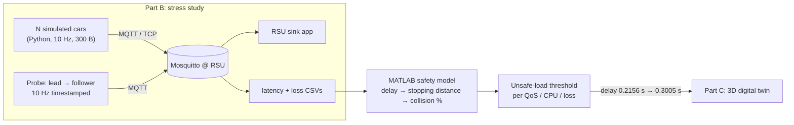
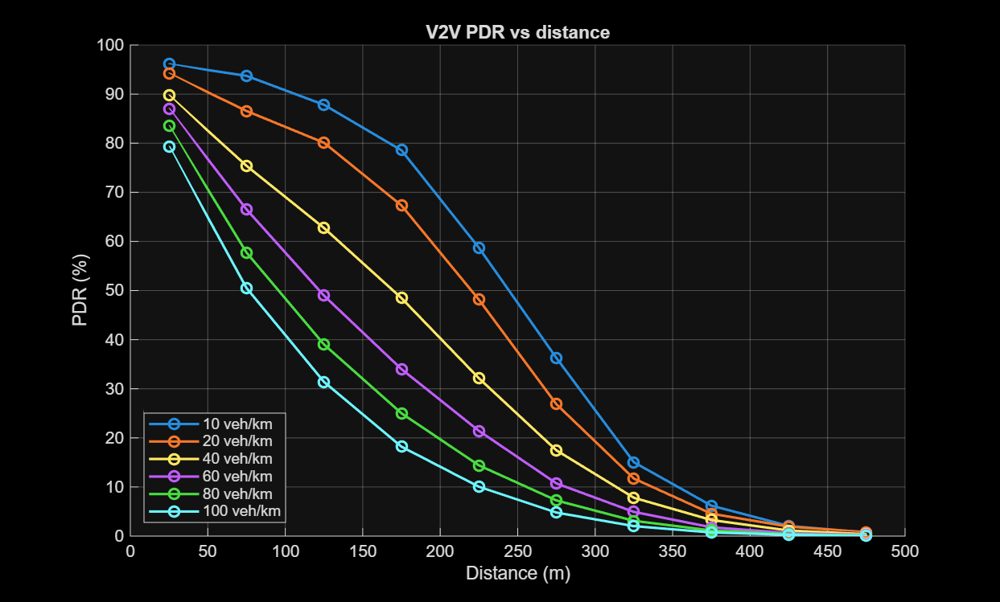
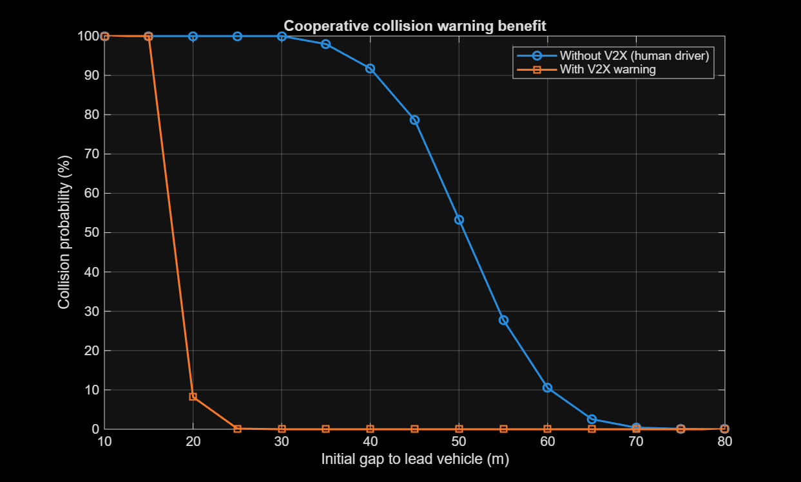
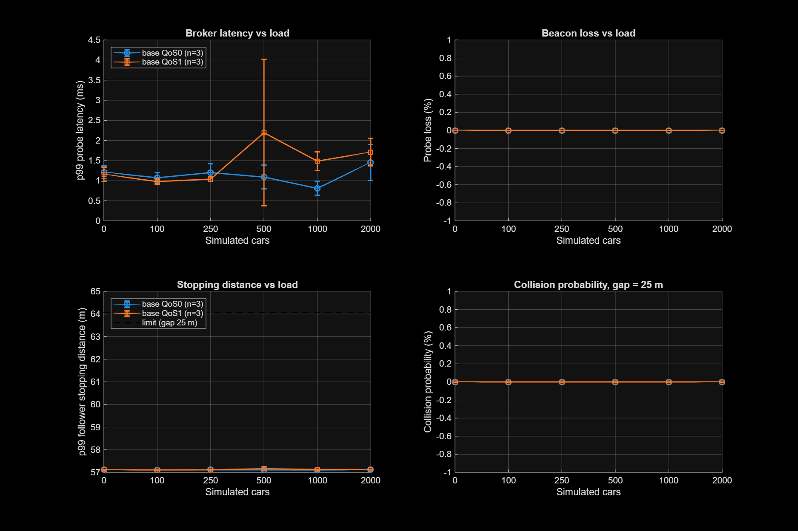

<h1 align="center">🚗📡 Can MQTT Brake a Car in Time?</h1>
<p align="center">
  <b>Safety viability of MQTT-based edge-RSU communication for cooperative collision warning</b><br>
  <i>M.Tech IoT project · NIT Delhi</i>
</p>

<p align="center">
  
  
  
  
  
  
</p>

---

## 🎯 The one-minute story

Cars in cooperative safety systems shout their position and speed **10 times a second**. The industry answer is DSRC (IEEE 802.11p) or C-V2X. **MQTT**, the lightweight pub/sub protocol of the IoT world, is normally dismissed as "too slow and too TCP-y" for emergency braking.

So we asked a different question: **if a roadside unit (RSU) runs an MQTT broker, how much load and packet loss can the system take before a follower car physically cannot stop in time?**

We didn't guess. We loaded a **real Mosquitto broker** with up to **2,000 simulated cars (20,000 msg/s)**, measured real latency, fed those numbers into a **braking-physics model**, and watched when collisions start.

> ### 💡 The surprising answer
> **The broker was never the problem. The network was.**
> Up to 20,000 msg/s, probe latency stayed around **1-2 ms (p99)**, even on a broker limited to **0.5 CPU core**.
> But inject just **1 % packet loss** and TCP turns every lost beacon into a **~200-300 ms stall**, enough to push the follower's stopping distance from **57.1 m to ~62-65 m** and cause **5-11 % collisions at a 20 m gap**.
> *TCP didn't drop the warnings. It delayed them, and in a braking scenario, late is as bad as lost.*

---

## 🧩 What's inside

| Part | What it is | Tools |
|------|-----------|-------|
| **A. Wireless baseline** | Highway V2V/V2I radio simulation (path loss, shadowing, interference) with a collision-warning app | MATLAB |
| **B. MQTT stress study** ⭐ | Real Mosquitto under load + packet loss + CPU cap → latency → stopping distance → collision probability | Python, Mosquitto, Docker, Clumsy, MATLAB |
| **C. Digital twin** | 3D animated scene, live MQTT network graph, RSU states, and a KPI dashboard (latency, PDR, TTC, gap) | MATLAB + Industrial Communication Toolbox |

**No machine learning anywhere.** Just networking, kinematics, and a lot of measured milliseconds.

## 🏗️ Architecture



Message flow in the digital twin (all through one real broker):

```
lead car ─ V2V telemetry (QoS 0) ───────────────────────────► follower
lead car ─ V2I hard-brake (QoS 1) ─► RSU ─(20 ms edge proc.)─ I2V warning (QoS 1) ─► follower
RSU      ─ V2N report (QoS 1, 1 Hz) ─► cloud
```

---

## 📊 Headline results

### Part A: the radio-only baseline
- Direct-radio PDR within 300 m drops from **~76 % → ~33 %** as density grows from 10 → 100 vehicles/km.
- A V2X warning shrinks the collision-free following gap from **~70 m → ~25 m**.

<p align="center">
  
  
</p>

### Part B: MQTT under stress (3 conditions × 2 QoS × 3 repeats × 6 load levels)

| Condition | Median latency | p99 latency | Probe loss | Safety verdict |
|-----------|:-------------:|:-----------:|:----------:|----------------|
| `base` (unrestricted broker) | 0.5-0.9 ms | ~1-2 ms | 0 % | ✅ Safe at all loads |
| `cpu05` (`--cpus=0.5`) | 0.5-0.7 ms | ~1-2 ms | 0 % | ✅ Probe stays safe... but see the caveat below |
| `loss1` (1 % packet loss) | ~1 ms | **~205-310 ms** | 0 % | ⚠️ 5-11 % collisions at 20 m gap, 0.6-1.9 % at 25 m, 0 % at 30 / 40 m |

<p align="center">
  
</p>

**Why "0 % probe loss" and yet unsafe?** With QoS 1 over TCP, nothing is *lost*, it is *retransmitted*. The packet arrives, just 200+ ms late. Reliability turned loss into latency.

**The RSU does choke at peak load.** On the 0.5-core broker at 2,000 cars (QoS 1), the generators pushed ~20,000 msg/s but the RSU sink received only ~22 % of it (3,477 messages in one run). Probe latency stayed low, but the edge application behind the broker could not keep up.

> ⚠️ **Honest caveat:** at 2,000 cars the sink also received only part of the load in the unrestricted run (QoS 1: ~57 %), so the Python generator/sink and host are part of that picture. Results at 2,000 cars are less reliable than those up to 1,000 cars. See `part_B_mqtt_stress/results/part_B_aggregated_results.csv` (`Sink_received_pct` column).

### Part C: the digital twin (real MQTT traffic)
Console confirmed `MQTT: connected to tcp://localhost:1883`.

| Driver mode | Outcome |
|-------------|---------|
| Manual (human reaction) | 💥 **Collision** at a 40 m initial gap |
| V2X + MQTT | ✅ **Braked safely**, 15.7 m gap remaining, **0 collisions**, min TTC = **2.50 s** |

402 real MQTT messages processed at ~309 ms mean latency, while the stress window used delays taken from Part B: **0.2156 s** (p99 at 0 cars, `loss1_q1_r3`) rising to **0.3005 s** (p99 at 2,000 cars).

<!-- Add your screenshots / GIF here once they're in part_C_digital_twin/media/ -->
<!--  -->

---

## 🚀 Reproduce it

### Prerequisites
| Need | Version |
|------|---------|
| MATLAB | R2021a+ (Part C needs **Industrial Communication Toolbox** for `mqttclient`) |
| Python | 3.8+ with `pip install -r requirements.txt` |
| Eclipse Mosquitto | from [mosquitto.org](https://mosquitto.org/download/) |
| Docker (WSL2 on Windows) | only for the `cpu05` condition |
| Clumsy (Windows) or `tc netem` (Linux) | only for the `loss1` condition |

### Part A
```matlab
cd part_A_baseline
v2x_sim            % writes results.csv and fig1..fig5
```

### Part B
```bash
cd part_B_mqtt_stress
mosquitto -c mosquitto.conf          # stop any Mosquitto Windows service first: net stop mosquitto

python run_matrix.py --label base    # unrestricted broker, no loss
```

**`cpu05`: CPU-limited broker (Docker)**
```bash
docker run --rm --cpus=0.5 -p 1883:1883 \
  -v "$PWD/mosquitto.conf:/mosquitto/config/mosquitto.conf" eclipse-mosquitto:2
python run_matrix.py --label cpu05
```

**`loss1`: 1 % packet loss (Clumsy, run as administrator)**
| Setting | Value |
|---------|-------|
| Filter | `tcp.DstPort == 1883 or tcp.SrcPort == 1883` |
| Drop | ✅ enabled, Chance = `1.0%` |

```bash
python run_matrix.py --label loss1
```

Then analyse (MATLAB):
```matlab
cd part_B_mqtt_stress/data
addpath('..')
v2x_safety_vs_load('base_q0_r1')   % one run -> safety table + figures
compare_configs                    % all conditions -> compare_configs.png + final_summary.csv
```

### Part C
```matlab
% With Mosquitto running on localhost:1883
cd part_C_digital_twin
v2x_iot_cps_sim                    % set P.saveVideo = true to export an MP4
```
No toolbox or broker? The script falls back to an in-process loopback broker (same topics, **not** real MQTT traffic).

---

## 🗂️ Repository layout

```
.
├── part_A_baseline/          v2x_sim.m, results.csv, fig1-5
├── part_B_mqtt_stress/
│   ├── mqtt_stress.py        load generator + latency probe
│   ├── run_matrix.py         runs QoS × repeats for one condition
│   ├── mosquitto.conf        broker config used for every test
│   ├── v2x_safety_vs_load.m  latency/loss → stopping distance → collision %
│   ├── compare_configs.m     overlays base / cpu05 / loss1
│   ├── data/                 raw latency, summary, safety CSVs (54 files)
│   └── results/              comparison figure, aggregated + unsafe-load tables
├── part_C_digital_twin/      v2x_iot_cps_sim.m, media/
└── docs/report/              full project report
```

## 🖥️ Test setup

Windows + WSL2 (Docker) · AMD Ryzen 7 · 16 GB RAM · integrated AMD Radeon · MATLAB with Industrial Communication Toolbox · Python + `paho-mqtt` · Mosquitto (native Windows build for `base`/`loss1`, `eclipse-mosquitto:2` Docker image for `cpu05`).

## ⚠️ Scope and limitations

- MQTT is evaluated as an **edge / V2N assist layer**, *not* a replacement for DSRC or C-V2X (PC5) direct links.
- The study isolates broker, host and injected-network effects. It does **not** model a real cellular or wireless access network.
- N cars are emulated by a few publisher processes, not N separate TCP connections.
- Loss and delay are injected on loopback, so they are an abstraction of a real RSU link.

## 📚 Related work
- Politecnico di Milano: MQTT latency of a roadside detection system for cooperative emergency braking
- *Electronics* (MDPI) 14(22):4509: MQTT vs ZeroMQ for V2X over 5G
- EURECOM: hierarchical MQTT brokers for CAM/DENM distribution
- Standards: IEEE 802.11p-2010, 3GPP TR 37.885, SAE J2735, ETSI EN 302 637-2

## 📄 Report
The full write-up is in [`docs/report/`](docs/report/).

## 👤 Author
**<YOUR NAME>** · M.Tech IoT, NIT Delhi · [LinkedIn](#) · [Email](#)

Licensed under the [MIT License](LICENSE).
